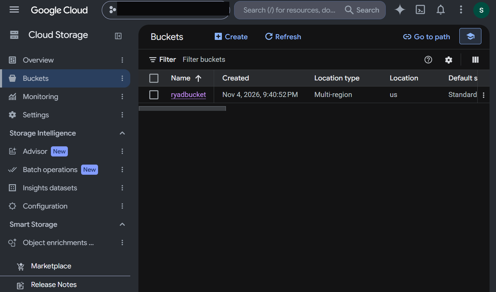
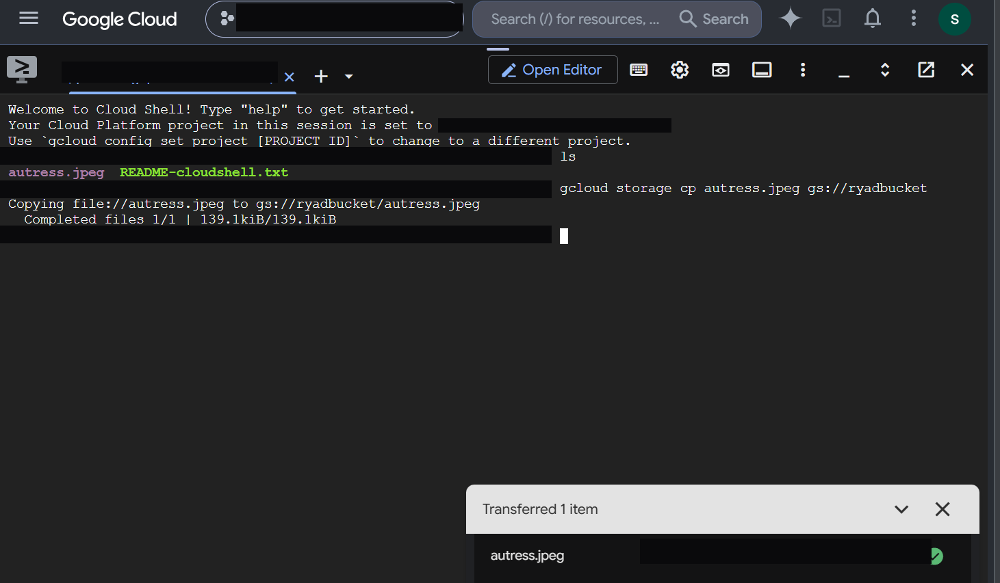
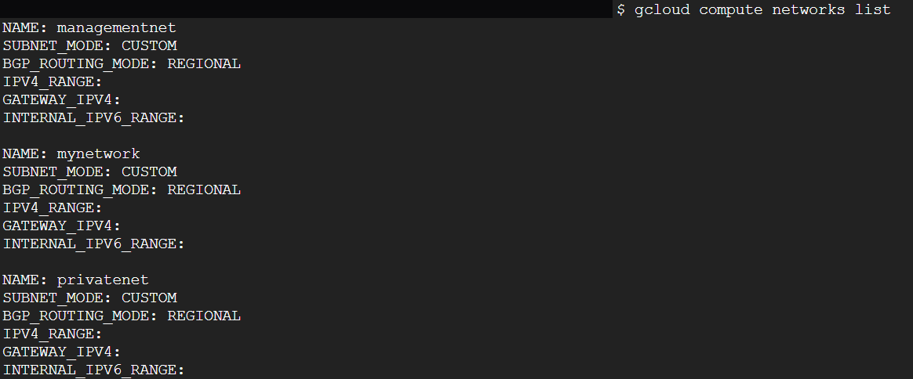
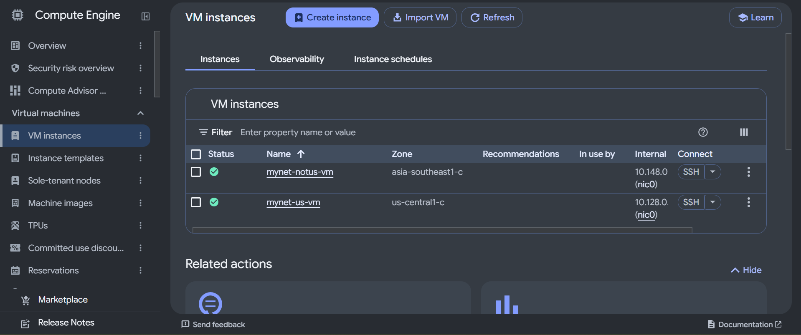
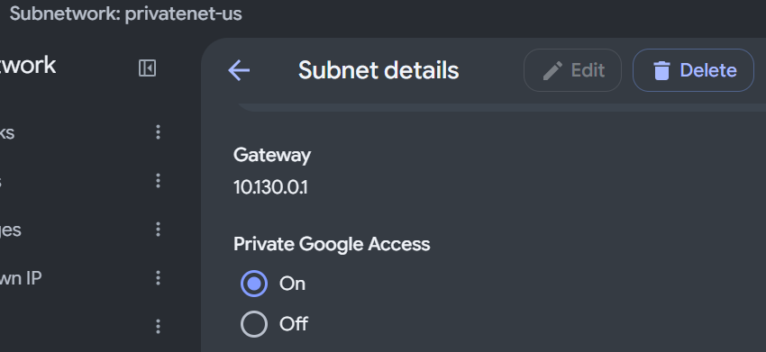
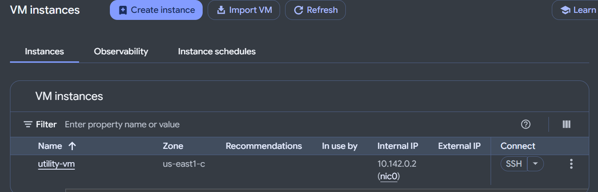
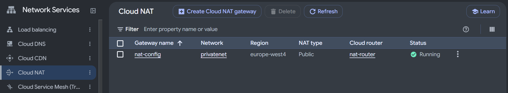

# Google Cloud Labs — Storage, VPC, Compute Engine & Cloud NAT

Hands-on Google Cloud labs completed through **Google Cloud training on
Coursera** (Qwiklabs-style sandbox environments), covering Cloud Storage,
custom VPC networking, Compute Engine, Private Google Access and Cloud NAT.

> **Scope note.** These are guided training labs run in separate, temporary
> Qwiklabs sandbox projects — not a production environment and not a single
> continuous deployment. Each lab below ran in its own ephemeral project, and
> two of them (the `utility-vm` instance and the Cloud NAT gateway) are from
> **different regions and different lab sessions**: they are documented as
> separate exercises, not as parts of one shared network architecture.

## Objective

Work through core Google Cloud building blocks from a security and
networking angle: object storage and the `gcloud` CLI, custom-mode VPC
design across regions, Compute Engine instance exposure (with and without a
public IP), Private Google Access for instances with no external IP, and
Cloud NAT as the mechanism that lets such instances still reach the
internet outbound.

## Environment

| Component | Detail |
|---|---|
| Platform | Google Cloud Platform, via Coursera Google Cloud training |
| Projects | Multiple temporary Qwiklabs sandbox projects (one per lab session, deleted after use) |
| Access | Browser-based Cloud Console and Cloud Shell, no local `gcloud` setup |

## What was actually done

### 1. Cloud Storage & Cloud Shell

Created a Cloud Storage bucket (`ryadbucket`, multi-region, US) from the
Cloud Console, then used **Cloud Shell** to copy a local file into it with
the `gcloud storage cp` command.

### 2. VPC — custom networks across regions

From Cloud Shell, listed the project's VPC networks with `gcloud compute
networks list`: three **custom-mode** networks (`managementnet`,
`mynetwork`, `privatenet`), each with its own subnets and routing rather
than relying on the auto-created default network.

### 3. Compute Engine — VM instances across regions

Reviewed two Compute Engine instances attached to `mynetwork`, deployed in
different regions to exercise cross-region connectivity on a custom VPC:
`mynet-notus-vm` (`asia-southeast1-c`) and `mynet-us-vm` (`us-central1-c`),
each with only an internal IP shown in this view.

### 4. Private Google Access

On the `privatenet-us` subnet (gateway `10.130.0.1`, part of the `privatenet`
network from step 2), enabled **Private Google Access**. This lets
instances on that subnet that have **no external IP** reach Google APIs and
services without needing a public address.

### 5. Compute Engine — a VM without an external IP

A **separate lab session**, in a different project and region
(`us-east1-c`): reviewed `utility-vm`, a Compute Engine instance with an
internal IP only and no External IP column value — reachable from inside
the VPC but not directly from the public internet.

### 6. Cloud NAT

Another **separate lab session**, region `europe-west4`: reviewed an active
Cloud NAT gateway (`nat-config`), attached to Cloud Router `nat-router` on
the `privatenet` network, type `Public`, status `Running`. Cloud NAT is the
piece that completes the picture from steps 4–5: it lets instances with no
external IP still make **outbound** connections to the internet (e.g. to
download packages), while remaining unreachable for **inbound** connections
from outside the VPC.

## What these labs taught

Private Google Access and Cloud NAT solve two different halves of the same
problem for an instance with no external IP: Private Google Access covers
reaching **Google's own APIs and services**, while Cloud NAT covers
reaching **the general internet** outbound, without either mechanism
exposing the instance to unsolicited inbound traffic. Designing with
custom-mode VPCs instead of the default network, and spreading instances
across regions on purpose, also made the difference between a network
that's merely functional and one whose subnetting and routing are
deliberate choices.

## Skills demonstrated

- Creating and using a Cloud Storage bucket, including file transfer from
  Cloud Shell with the `gcloud storage` command group.
- Designing and inspecting custom-mode VPC networks and their subnets,
  rather than relying on the auto-created default network.
- Deploying and reviewing Compute Engine instances across multiple regions
  on a shared custom VPC.
- Distinguishing an instance with only an internal IP from one with a
  public IP, and reasoning about what each configuration exposes.
- Enabling Private Google Access on a subnet, and explaining why it is
  needed for instances with no external IP.
- Configuring and verifying a Cloud NAT gateway, and explaining the
  difference between the outbound connectivity it provides and the
  inbound exposure it does not.

## Limitations

- These are **training labs in temporary Qwiklabs-style sandbox projects**,
  not a production GCP environment — each ran in its own disposable project,
  deleted after the session.
- The screenshots come from **at least three separate lab sessions**
  (Cloud Storage; the custom VPC + Private Google Access lab; the
  `utility-vm` lab; the Cloud NAT lab), run in different projects and, for
  `utility-vm` and Cloud NAT, different regions. They are documented here
  as distinct exercises and are **not** presented as one continuous network
  topology.
- No command-line or console verification of actual outbound connectivity
  through the Cloud NAT gateway (e.g. a reachability test from an instance
  behind it) was captured — the screenshot confirms the gateway's
  configuration and `Running` status, not a live traffic test.
- Screenshots had their Qwiklabs-generated temporary project IDs and
  student usernames (e.g. `qwiklabs-gcp-02-88d38bc21b1f`,
  `student_03_1bd1fe284f36@cloudshell`) redacted before publication. These
  identifiers are disposable, randomly assigned per session and not linked
  to any persistent account or reachable outside that temporary
  environment, but are masked here for consistency with the rest of the
  portfolio.

## Portfolio

Full write-up and context: [ryad-cyber.github.io](https://ryad-cyber.github.io/#p-gcp)
